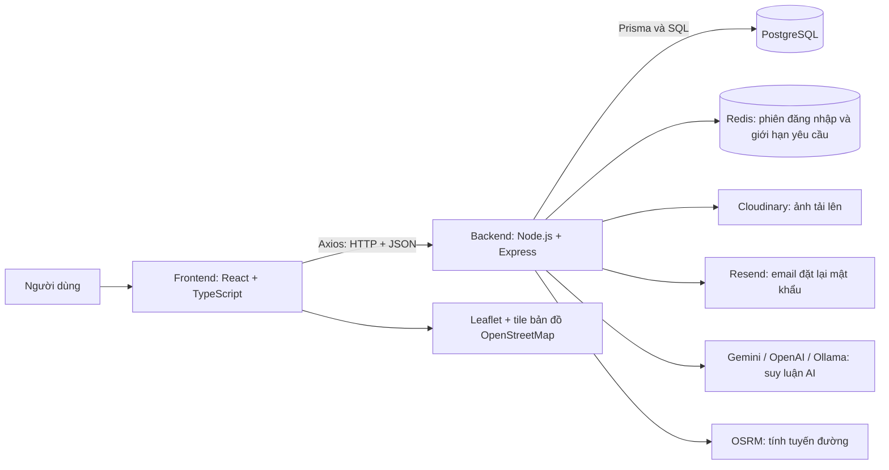

# Thuật ngữ và công nghệ trong Travel Platform

Tài liệu dành cho người mới, đối chiếu với mã nguồn worktree `ai-chat-travel-2` ngày 17/10/2026.

Mỗi mục trả lời: **là gì → dùng để làm gì → dự án sử dụng thế nào**. Tên sản phẩm như React, Prisma, Cloudinary không nhất thiết là từ viết tắt. Các khái niệm nền tảng được đưa vào để bạn đọc hiểu mã nguồn; một khái niệm được giải thích không đồng nghĩa dự án đã triển khai mọi tính năng của nó.

## 1. Nhìn toàn bộ hệ thống



Ví dụ: bạn mở chuyến đi → React gọi API → Express xác thực tài khoản → Prisma truy vấn PostgreSQL → dữ liệu JSON trở về React → giao diện hiển thị lịch trình.

## 2. JWT — ví dụ giải thích đầy đủ

### JWT là gì?

**JWT = JSON Web Token**: một định dạng token chứa các thông tin gọi là **claims**. Trong dự án, backend tạo JWT có mã kiểm tra tính toàn vẹn bằng thuật toán HS256 để xác nhận token được tạo bằng khóa bí mật phù hợp và chưa bị sửa. Định nghĩa tiêu chuẩn: [RFC 7519](https://www.rfc-editor.org/rfc/rfc7519.html).

Bạn có thể hình dung access token như **vé truy cập có thời hạn**. Sau khi đăng nhập, người dùng đưa vé này kèm các yêu cầu cần xác thực, thay vì gửi lại mật khẩu cho từng thao tác.

### Dự án dùng JWT làm gì?

- Xác định tài khoản đang gọi API.
- Bảo vệ chức năng chuyến đi, yêu thích, hồ sơ và AI Chat.
- Kết hợp kiểm tra quyền để bảo vệ chức năng quản trị.
- Cấp token mới khi access token hết hạn thông qua luồng refresh.
- Ký bằng chứng cho bản nháp lịch trình AI trong một luồng riêng.

### Hai loại token đăng nhập

| Loại | Vai trò | Dự án lưu ở đâu? | Thời hạn đang cấu hình khi rà soát |
| --- | --- | --- | --- |
| Access token | Gửi kèm yêu cầu API cần đăng nhập. | Bộ nhớ của ứng dụng frontend, tại `frontend/src/utils/access-token.store.ts`. | 15 phút, lấy từ `JWT_ACCESS_EXPIRES_IN`. |
| Refresh token | Xin cấp lại access token, không dùng thay access token để gọi API chuyến đi. | Cookie `refreshToken` có HttpOnly ở trình duyệt; Redis lưu mã phiên JTI và user ID để kiểm tra việc sử dụng/thu hồi. | 30 ngày, lấy từ `JWT_REFRESH_EXPIRES_IN`. |

Các thời hạn có thể đổi trong cấu hình. Không đưa giá trị khóa bí mật vào tài liệu hoặc ảnh chụp chia sẻ.

### Luồng hoạt động thực tế

1. Người dùng gửi email/mật khẩu đến `POST /api/v1/auth/login`.
2. Backend tìm tài khoản và dùng `bcrypt.compare()` để kiểm tra mật khẩu với bản băm.
3. Khi hợp lệ, backend tạo access token và refresh token; đăng ký phiên làm mới trong Redis.
4. Access token được trả trong dữ liệu phản hồi; refresh token được đặt bằng cookie HttpOnly.
5. Axios lấy access token từ bộ nhớ và gắn vào header:

   ```http
   GET /api/v1/trips
   Authorization: Bearer <access_token>
   ```

6. Middleware `authenticate` kiểm tra token: thuật toán, tính toàn vẹn, hạn dùng và loại token. Nó còn truy vấn người dùng để kiểm tra tài khoản tồn tại và đang hoạt động.
7. Backend tiếp tục kiểm tra quyền đối với tài nguyên. Ví dụ: biết bạn là user 7 vẫn phải kiểm tra chuyến đi có thuộc user 7 hay không.
8. Khi một yêu cầu nhận 401 đủ điều kiện thử làm mới, Axios gọi `POST /auth/refresh`. Trình duyệt gửi cookie theo cấu hình `withCredentials`.
9. Backend kiểm tra refresh token và dùng Redis `GETDEL` để tiêu thụ mã phiên cũ một lần; sau đó cấp cặp token với JTI mới. Đây là **refresh token rotation**.
10. Khi đăng xuất, frontend xóa access token; backend thu hồi phiên làm mới và xóa cookie. Access token đã phát hành không có danh sách thu hồi riêng trong middleware hiện tại; nếu bị sao chép, token đó có thể còn hợp lệ đến hạn, tùy trạng thái tài khoản và các kiểm tra quyền.

### Trong JWT có gì?

JWT ký theo định dạng đang dùng thường gồm ba phần, phân cách bằng dấu chấm:

```text
header.payload.signature
```

Ví dụ payload minh họa, không phải token thật:

```json
{
  "type": "access",
  "sub": "7",
  "userId": 7,
  "email": "demo@example.com",
  "role": "USER",
  "iat": 1792195200,
  "exp": 1792196100
}
```

| Thành phần | Nghĩa | Dùng thế nào? |
| --- | --- | --- |
| Header | Thông tin loại token/thuật toán. | Có thể mô tả `alg: HS256`. |
| Payload | Dữ liệu claims. | Access token có `userId`, `email`, `role`, `type` và thông tin thời gian. |
| Signature | Phần kiểm tra tính toàn vẹn. | Backend dùng khóa bí mật để kiểm tra; sửa payload sẽ làm kiểm tra thất bại. |
| `sub` — Subject | Chủ thể token. | Dự án lưu user ID dưới dạng chuỗi. |
| `iat` — Issued At | Thời điểm phát hành. | Thư viện JWT gắn thời điểm tạo token. |
| `exp` — Expiration Time | Thời điểm hết hạn. | Backend từ chối token hết hạn. |
| `jti` — JWT ID | Mã định danh token. | Dùng trong refresh token để gắn với một phiên Redis. |
| `iss` — Issuer | Bên phát hành token. | Luồng bằng chứng bản nháp AI dùng issuer riêng. |
| `aud` — Audience | Đối tượng/mục đích nhận token. | Bằng chứng AI giới hạn cho luồng tạo chuyến đi. |

**JWT HS256 trong dự án được ký/kiểm tra tính toàn vẹn, không mã hóa nội dung payload.** Base64url là cách biểu diễn dữ liệu, không phải mã hóa bảo mật. Không đặt mật khẩu vào JWT. Header `Bearer` có nghĩa bên giữ token có thể trình token để truy cập trong phạm vi được phép.

Mã liên quan: `backend/src/utils/jwt.utils.ts`, `backend/src/services/auth.service.ts`, `backend/src/middlewares/auth.middleware.ts`, `backend/src/utils/auth-cookie.utils.ts`, `backend/src/utils/token-session.ts`, `frontend/src/api/axiosClient.ts`.

## 3. Nhóm ứng dụng web và giao tiếp

| Thuật ngữ | Là gì? | Dùng thế nào trong dự án? |
| --- | --- | --- |
| Frontend | Phần ứng dụng hiển thị và tương tác trong trình duyệt. | Thư mục `frontend/`: tìm địa điểm, xem bản đồ, kéo thả, chat và biểu mẫu. |
| Backend | Phần chương trình xử lý ở phía máy chủ. | Thư mục `backend/`: kiểm tra quyền, tính toán, truy vấn database, gọi AI và dịch vụ ảnh. |
| Full-stack | Bao gồm frontend và backend. | Travel Platform có cả giao diện, API và lưu trữ dữ liệu. |
| Client / Server | Bên gửi yêu cầu / bên cung cấp phản hồi. | Trình duyệt là client của Express; Express lại là client khi gọi OSRM hoặc Gemini. |
| UI — User Interface | Giao diện người dùng. | Nút lưu chuyến đi, thẻ địa điểm, hộp thoại thanh toán. |
| UX — User Experience | Trải nghiệm khi thực hiện một công việc. | Báo lỗi dễ hiểu, khôi phục thứ tự khi kéo thả thất bại, giữ nội dung để người dùng thử lại. |
| API — Application Programming Interface | Giao diện quy định cách các phần mềm trao đổi với nhau. | Frontend gọi `/api/v1/trips`; backend gọi API AI, Cloudinary hoặc OSRM. |
| REST — Representational State Transfer | Phong cách thiết kế giao tiếp theo tài nguyên và các quy tắc HTTP. | API dự án tổ chức theo tài nguyên như `/trips`, `/destinations`, `/reviews`, theo kiểu REST. |
| Endpoint | Một điểm truy cập API, được xác định bởi phương thức và đường dẫn. | `GET /api/v1/trips` lấy danh sách; `POST /api/v1/trips` tạo chuyến đi. |
| HTTP — Hypertext Transfer Protocol | Giao thức yêu cầu/phản hồi của web. | Trình duyệt trao đổi dữ liệu với API. |
| HTTPS — HTTP over TLS | HTTP được bảo vệ bằng TLS khi truyền trên mạng. | Dịch vụ AI/ảnh thường dùng URL HTTPS; môi trường local trong cấu hình dùng HTTP. |
| TLS — Transport Layer Security | Cơ chế bảo vệ dữ liệu trên đường truyền và xác thực đầu bên kia theo chứng chỉ. | Được dùng khi gọi các URL `https://...`; không phải cơ chế ký JWT. |
| URL — Uniform Resource Locator | Địa chỉ của một tài nguyên. | `imageUrl` trỏ tới ảnh; `coordinateSourceUrl` trỏ tới nguồn tọa độ. |
| URI — Uniform Resource Identifier | Khái niệm định danh tài nguyên rộng hơn URL. | Thường xuất hiện trong tài liệu OAuth ở tên `redirect URI`/callback URI. |
| Request / Response | Yêu cầu gửi đi / phản hồi nhận lại. | Yêu cầu tạo chuyến đi chứa ngày và tên; phản hồi chứa chuyến đi đã tạo hoặc lỗi. |
| Header | Thông tin đi kèm request/response, ngoài phần dữ liệu chính. | `Authorization`, `Content-Type`, `Cache-Control`, `Set-Cookie`. |
| Body | Phần nội dung dữ liệu của request hoặc response. | Khi tạo chuyến đi, body chứa tên, ngày, số người và ngân sách. |
| Params / Query | Giá trị nằm trong đoạn đường dẫn / sau dấu `?`. | `/trips/7`: `tripId=7` là param; `/destinations?page=2`: `page=2` là query. |
| JSON — JavaScript Object Notation | Định dạng dữ liệu dạng văn bản, dùng được với nhiều ngôn ngữ. | API trao đổi các đối tượng có trường `success`, `message`, `data`; không chỉ dùng trong JavaScript. |
| Serialization | Chuyển dữ liệu sang dạng trao đổi/lưu trữ. | Backend đổi Decimal thành chuỗi và ngày thành chuỗi trước khi trả JSON. |
| GET / POST / PUT / PATCH / DELETE | Các phương thức HTTP để đọc, gửi xử lý/tạo, thay thế biểu diễn, sửa một phần, xóa. | Dự án dùng PUT gửi toàn bộ danh sách thứ tự điểm của một ngày; PATCH sửa các trường được cung cấp. |
| HTTP status code | Mã mô tả kết quả yêu cầu. | 200: thành công; 201: đã tạo; 401: chưa xác thực hợp lệ; 403: bị từ chối; 404: không tìm thấy; 409: xung đột; 422: dữ liệu không hợp lệ; 429: quá nhiều yêu cầu; 5xx: lỗi phía máy chủ/dịch vụ. |
| Pagination | Chia dữ liệu thành nhiều trang. | API danh sách dùng `page`, `limit` và tổng số bản ghi để tránh tải mọi địa điểm cùng lúc. |
| localhost / 127.0.0.1 | Địa chỉ trỏ về chính máy đang sử dụng. | Dùng để frontend/backend kết nối các dịch vụ local. |
| Port — cổng | Số dùng phân biệt dịch vụ mạng trên cùng một địa chỉ. | Theo cấu hình: frontend 5173, backend 3000, PostgreSQL qua Docker 5433, Redis qua Docker 6380. |

## 4. Nhóm ngôn ngữ, giao diện và công cụ frontend

| Thuật ngữ / công nghệ | Là gì? | Dùng thế nào trong dự án? |
| --- | --- | --- |
| HTML — HyperText Markup Language | Ngôn ngữ mô tả cấu trúc trang web. | Trình duyệt hiển thị tiêu đề, biểu mẫu, ảnh và nút được React tạo ra. |
| CSS — Cascading Style Sheets | Ngôn ngữ định dạng giao diện. | Quy định màu, khoảng cách, bố cục và chuyển động. |
| JavaScript / JS | Ngôn ngữ lập trình chạy trong trình duyệt và các môi trường như Node.js. | Mã frontend/backend cuối cùng được chạy dưới dạng JavaScript. |
| TypeScript / TS | JavaScript được bổ sung hệ thống kiểu và công cụ kiểm tra khi phát triển. | File `.ts`, `.tsx` mô tả kiểu chuyến đi, tham số hàm và dữ liệu phản hồi. Kiểu TypeScript không tự kiểm tra dữ liệu đầu vào lúc chạy. |
| JSX — JavaScript XML | Cú pháp mô tả giao diện dạng thẻ trong JavaScript. | Viết `<TripTimeline day={selectedDay} />` trong React. |
| TSX | Phần mở rộng tệp TypeScript cho phép chứa JSX. | Các component/trang React thường có đuôi `.tsx`; không phải một framework riêng. |
| React | Thư viện xây dựng giao diện bằng component. | Hiển thị các trang và cập nhật giao diện khi dữ liệu thay đổi. |
| React DOM | Phần kết nối React với DOM của trình duyệt. | `frontend/src/main.tsx` gắn ứng dụng vào trang HTML. |
| DOM — Document Object Model | Cây đối tượng biểu diễn nội dung tài liệu trong trình duyệt. | React cập nhật các phần tử hiển thị; ví dụ thêm một dòng lịch trình. |
| Component | Một khối giao diện có thể tái sử dụng. | `TripCard`, `TripTimeline`, `Modal`, `TripExpenses`. |
| Props | Dữ liệu được truyền từ component cha xuống component con. | `TripTimeline` nhận ngày đang chọn và các hàm chỉnh/xóa/sắp xếp. |
| State | Trạng thái mà component ghi nhớ và dùng để dựng giao diện. | `isSending` cho biết AI Chat đang gửi; `selectedDayId` là ngày đang chọn. |
| Hook | Hàm cho phép component sử dụng các tính năng React. | `useState` giữ trạng thái; `useEffect` đồng bộ với tác vụ ngoài React; `useRef` giữ tham chiếu; `useMemo` ghi nhớ kết quả; `useCallback` ghi nhớ hàm. |
| Context | Cơ chế cung cấp dữ liệu cho nhiều component trong cây React. | `AuthContext` chia sẻ thông tin tài khoản và các thao tác phiên đăng nhập. |
| React Router | Thư viện điều hướng và ánh xạ URL sang trang React. | `/trips/:id` mở `TripDetailPage`, `/ai-chat` mở trang chat. |
| SPA — Single-Page Application | Ứng dụng thay đổi phần giao diện trong một trang nền khi điều hướng. | React Router chuyển giữa nhiều màn hình mà không cần mỗi lần đều tải lại toàn bộ tài liệu HTML. |
| CSR — Client-Side Rendering | Dựng giao diện bằng JavaScript phía trình duyệt. | Đây là cách ứng dụng React/Vite hiện tại hiển thị giao diện chính. |
| SSR — Server-Side Rendering | Dựng HTML bằng chương trình phía máy chủ. | Một số kiểm thử dùng render phía server để kiểm tra component; điều đó không có nghĩa website đang triển khai SSR cho các trang. |
| ProtectedRoute / AdminRoute | Component kiểm tra điều kiện trước khi hiển thị trang. | Chặn mở giao diện yêu cầu đăng nhập/quyền quản trị; API backend vẫn phải tự kiểm tra quyền. |
| Lazy loading / Code splitting | Tải phần mã khi cần / chia mã thành các phần. | `React.lazy()` tách các trang thành những gói có thể tải riêng. |
| Suspense | Cơ chế React để hiển thị nội dung chờ trong các tình huống được hỗ trợ. | Bao các trang lazy bằng giao diện loading khi mã trang chưa tải xong. |
| Tailwind CSS | Công cụ tạo CSS từ các lớp tiện ích. | `rounded-xl`, `px-4`, `grid`, `text-sm` được dùng trực tiếp trong JSX. |
| Responsive | Bố cục thích ứng với kích thước màn hình. | Các lớp `sm:`, `lg:` điều chỉnh giao diện điện thoại và desktop. |
| Vite | Công cụ chạy server phát triển và đóng gói frontend. | `npm run dev` chạy giao diện; `vite build` tạo bản build. |
| HMR — Hot Module Replacement | Cập nhật module trong lúc phát triển mà không tải lại toàn bộ trang cho mọi thay đổi. | Vite kết hợp React plugin để hiển thị nhiều thay đổi mã giao diện nhanh hơn. |
| Axios | Thư viện gửi HTTP request. | Các file `frontend/src/services/` gọi API qua một `axiosClient` dùng chung. |
| Interceptor | Hàm chặn/xử lý request hoặc response ở một điểm chung. | Axios gắn access token và xử lý luồng làm mới khi gặp 401 phù hợp. |
| Debounce | Chờ người dùng ngừng thao tác một khoảng ngắn trước khi thực hiện. | Tìm kiếm địa điểm tránh gọi API cho mọi lần gõ ngay lập tức. |
| DnD — Drag and Drop | Kéo và thả. | Sắp xếp hoạt động trong ngày. |
| dnd-kit | Bộ thư viện triển khai kéo thả trong React. | Gồm core, sortable và utilities để đổi thứ tự điểm, hỗ trợ cảm biến chuột/chạm/bàn phím. |
| Modal / Toast / Skeleton | Hộp thoại nổi / thông báo ngắn / giao diện giữ chỗ khi tải. | Biểu mẫu chỉnh sửa, báo lưu thành công, màn hình tải chuyến đi. |
| ARIA — Accessible Rich Internet Applications | Tập thuộc tính hỗ trợ khả năng tiếp cận cho giao diện web. | `aria-label`, `aria-live`, `aria-busy` giúp công cụ hỗ trợ hiểu nút/thông báo/trạng thái. |
| SVG — Scalable Vector Graphics | Định dạng đồ họa vector. | Nhiều icon và một số tài nguyên logo/ảnh thay thế được tạo bằng SVG. |
| JPEG / PNG / WebP | Các định dạng ảnh raster, tức ảnh tạo từ điểm ảnh. | Dự án có ảnh địa điểm `.jpg`, `.webp`, logo `.png`; browser tải theo `imageUrl`. |

Ví dụ state/hook trong dự án: đổi `selectedDayId` bằng `useState` → React hiển thị timeline và bản đồ của ngày được chọn. Tham khảo [React Hooks](https://react.dev/reference/react/hooks).

## 5. Nhóm backend, kiến trúc và thư viện

| Thuật ngữ / công nghệ | Là gì? | Dùng thế nào trong dự án? |
| --- | --- | --- |
| Node.js | Môi trường chạy JavaScript ngoài trình duyệt. | Chạy backend Express và các script quản trị/import dữ liệu. |
| Express | Framework web cho Node.js. | Định nghĩa endpoint, ghép middleware và trả HTTP response. |
| Route | Quy tắc ánh xạ URL/phương thức đến phần xử lý. | `backend/src/routes/trip.routes.ts` khai báo các API chuyến đi. |
| Middleware | Hàm được chạy trên đường xử lý request. | Xác thực, kiểm tra quyền, kiểm tra dữ liệu, nhận file hoặc xử lý lỗi. |
| Controller | Lớp tiếp nhận dữ liệu HTTP và gọi xử lý nghiệp vụ. | `trip.controller.ts` lấy user ID và tham số, gọi service rồi trả response. |
| Service | Phần xử lý quy tắc nghiệp vụ. | Kiểm tra ngày chuyến đi, chặn trả vượt số còn nợ, điều phối AI và định tuyến. |
| Repository | Phần gom các truy vấn lưu trữ dữ liệu. | `trip.repository.ts` đọc/ghi chuyến đi qua Prisma. Một số service mới truy cập Prisma trực tiếp; không phải mọi module đều có đủ mọi lớp. |
| Business logic | Các quy tắc đặc thù của ứng dụng. | Chỉ chủ chuyến đi được sửa; kết thúc phải sau bắt đầu; thanh toán không vượt khoản còn lại. |
| CRUD — Create, Read, Update, Delete | Bốn nhóm thao tác tạo, đọc, cập nhật và xóa dữ liệu. | Quản lý địa điểm, chuyến đi, ngày và hoạt động. |
| DTO — Data Transfer Object | Cấu trúc dữ liệu truyền giữa các phần hệ thống. | `LoginDto` mô tả dữ liệu đăng nhập được service nhận. |
| Type / Interface | Cách TypeScript mô tả hình dạng và quy tắc kiểu dữ liệu. | `TripDetail`, `AiChatResult`, `ExpensePayload` giúp phát hiện dùng sai trường khi viết code. |
| Validation | Kiểm tra dữ liệu có hợp lệ không. | Email đúng dạng, số người dương, ngày tồn tại, tiền không âm. |
| Zod | Thư viện định nghĩa schema và kiểm tra dữ liệu khi chạy. | `trip.validator.ts` kiểm tra request trước khi chuyển vào xử lý. |
| Error handling / AppError | Cách biểu diễn và phản hồi lỗi có kiểm soát. | Service ném `AppError`; middleware chung chuyển thành response JSON có HTTP status. |
| express-async-errors | Thư viện chuyển lỗi từ nhiều async route/middleware về xử lý lỗi Express. | Import tại đầu `backend/src/app.ts` để hỗ trợ các handler bất đồng bộ. |
| async / await / Promise | Cơ chế viết và phối hợp công việc bất đồng bộ. | Chờ truy vấn database hoặc API; `Promise.all` phối hợp nhiều công việc độc lập. |
| Concurrency | Nhiều công việc đang được xử lý chồng lấp. | Giới hạn số yêu cầu AI/định tuyến đang chạy; không đồng nghĩa mọi việc chạy trên các CPU khác nhau. |
| Race condition | Kết quả phụ thuộc thứ tự các thao tác đồng thời. | Hai yêu cầu cùng thanh toán số tiền còn lại phải được kiểm soát để tránh ghi quá số nợ. |
| CAS — Compare-and-Swap | Chỉ cập nhật nếu giá trị phiên bản hiện tại vẫn khớp giá trị đã đọc. | Dự án dùng `updatedAt`/snapshot để phát hiện dữ liệu bị sửa trong lúc xử lý. |
| Singleton | Dùng chung một instance thay vì tạo nhiều instance tùy tiện. | `backend/src/config/db.ts` cung cấp Prisma client dùng chung trong tiến trình. |
| Adapter | Phần chuyển giữa giao diện nội bộ và định dạng của dịch vụ khác. | Adapter AI xử lý định dạng Gemini/OpenAI/Ollama; adapter bản đồ xử lý kết quả OSRM. |
| Timeout | Giới hạn thời gian chờ. | Dừng đợi khi AI/OSRM phản hồi quá lâu. |
| Retry | Thử lại sau một lần thất bại phù hợp. | Một số yêu cầu dịch vụ và transaction có cơ chế thử lại giới hạn; không phải mọi lỗi đều được thử lại. |
| Fallback | Phương án thay thế khi cách ưu tiên không dùng được. | Kéo thả chuyển sang ước tính chặng; bản đồ nền chuyển tile provider dự phòng. |
| AbortController / AbortSignal | Cơ chế phát tín hiệu hủy công việc. | Hủy yêu cầu tìm kiếm cũ hoặc dừng định tuyến khi hết thời hạn. |
| Health check | Endpoint dùng kiểm tra trạng thái phản hồi của ứng dụng. | `/api/v1/health` trả trạng thái API; handler hiện tại không tự truy vấn thử mọi dịch vụ phụ thuộc. |

### Các tên package phụ trợ thường gặp trong `package.json`

| Package | Là gì và được dùng làm gì? |
| --- | --- |
| `jsonwebtoken` | Thư viện Node.js cung cấp các hàm tạo và kiểm tra JWT; JWT là định dạng, thư viện này là công cụ triển khai. |
| `cookie-parser` | Middleware đọc header Cookie của request thành `req.cookies`, để backend lấy refresh token/OAuth state. |
| `cors` | Package Express giúp cấu hình các HTTP header phục vụ cơ chế CORS của trình duyệt. |
| `express-rate-limit` | Middleware đếm và giới hạn số request theo khoảng thời gian/cách xác định client đã cấu hình. |
| `passport-google-oauth20` | Package bổ sung Google OAuth 2.0 strategy cho Passport; khác thư viện Passport lõi. |
| `@prisma/client` / `prisma` | Package client truy vấn dùng trong mã / package cung cấp các công cụ CLI như migrate, generate, studio. |
| `@vitejs/plugin-react` | Plugin đưa hỗ trợ React, xử lý JSX và tích hợp cập nhật React trong lúc phát triển vào Vite. |
| `@dnd-kit/core` / `sortable` / `utilities` | Lõi nhận thao tác kéo thả / hỗ trợ danh sách có thể sắp xếp / hàm tiện ích như chuyển transform thành CSS. |
| `typescript-eslint` / `@typescript-eslint/*` | Bộ công cụ để ESLint đọc và kiểm tra mã TypeScript. |
| `eslint-plugin-react-hooks` | Các quy tắc lint giúp kiểm tra cách dùng React Hooks và phụ thuộc effect/hook. |
| `eslint-plugin-react-refresh` | Quy tắc lint liên quan đến cấu trúc module để hỗ trợ React Fast Refresh khi phát triển. |
| `node:crypto` / `crypto` | Module sẵn có trong Node.js cho các công việc như số ngẫu nhiên an toàn, UUID và hàm băm. |
| `node:fs`, `path`, `url` | Các module Node.js làm việc với tệp, đường dẫn hệ điều hành và URL; không phải dịch vụ ngoài. |
| Fetch API | Giao diện gửi HTTP request có trong browser và các phiên bản Node.js phù hợp; adapter backend dùng `fetch` để gọi một số provider. |

## 6. Nhóm xác thực, phân quyền và bảo mật

| Thuật ngữ / công nghệ | Là gì? | Dùng thế nào trong dự án? |
| --- | --- | --- |
| Authentication / AuthN | Xác thực: xác định người đang truy cập là ai. | Kiểm tra đăng nhập và JWT qua middleware `authenticate`. |
| Authorization / AuthZ | Phân quyền: xác định người đó được làm gì. | Kiểm tra role quản trị và quyền sở hữu chuyến đi/hội thoại/chi phí. |
| RBAC — Role-Based Access Control | Phân quyền theo vai trò. | `USER` và `ADMIN`, cùng middleware `requireRole`. |
| Ownership check | Kiểm tra tài nguyên thuộc ai. | Truy vấn chuyến đi kèm `userId`, không chỉ dựa vào ID chuyến đi mà client gửi. |
| JWT — JSON Web Token | Định dạng token chứa claims. | Chi tiết tại mục 2: access/refresh và bằng chứng bản nháp AI. |
| Token | Chuỗi/đối tượng được dùng làm bằng chứng, thông tin cấp quyền hoặc mã xác nhận trong một luồng cụ thể. | JWT đăng nhập, token đặt lại mật khẩu và share token có vai trò khác nhau; không phải token nào cũng là JWT. |
| Bearer token | Token mà bên nắm giữ có thể trình để xin truy cập theo phạm vi token. | Header `Authorization: Bearer ...` gửi access token đến API. |
| HS256 | HMAC dùng SHA-256, một thuật toán kiểm tra tính toàn vẹn bằng khóa bí mật chung. | `jsonwebtoken` tạo và kiểm tra access/refresh token. |
| HMAC — Hash-based Message Authentication Code | Mã xác thực thông điệp dựa trên hàm băm và khóa bí mật. | Phát hiện dữ liệu token bị sửa khi không có khóa phù hợp. |
| SHA-256 — Secure Hash Algorithm 256-bit | Hàm tạo giá trị băm 256 bit từ dữ liệu đầu vào. | Băm token reset mật khẩu và dữ liệu bản nháp AI; không dùng thay bcrypt để lưu mật khẩu người dùng. |
| Hash / Băm | Biến đổi dữ liệu thành giá trị băm để kiểm tra/đối chiếu. | Backend lưu `passwordHash` thay mật khẩu gốc; không có thao tác giải băm để lấy mật khẩu. |
| bcrypt / bcryptjs | Thuật toán băm mật khẩu có tham số chi phí / thư viện triển khai bằng JavaScript. | Đăng ký dùng `bcrypt.hash`; đăng nhập dùng `bcrypt.compare`. |
| Salt / Cost factor | Dữ liệu ngẫu nhiên cho mỗi bản băm / tham số làm tăng chi phí tính toán. | bcrypt tạo salt, đưa thông tin cần thiết vào chuỗi hash và dùng mức chi phí theo chỗ gọi trong mã. |
| Secret | Giá trị bí mật phía máy chủ. | Các khóa ký JWT, API secret và khóa ký bản nháp được cấu hình ở backend. |
| API key | Khóa để ứng dụng gọi dịch vụ của nhà cung cấp. | Backend dùng khi gọi Gemini, Cloudinary hoặc Resend; khác với access token đăng nhập của người dùng. |
| Cookie | Dữ liệu trình duyệt quản lý và có thể gửi kèm request theo các quy tắc cookie. | Refresh token và mã OAuth state được đặt trong cookie. |
| HttpOnly | Thuộc tính ngăn JavaScript trang đọc cookie qua API như `document.cookie`. | Bảo vệ việc đọc refresh token trực tiếp từ mã trang; browser vẫn có thể gửi cookie theo request. |
| Secure cookie | Thuộc tính giới hạn gửi cookie qua kênh an toàn theo quy tắc trình duyệt. | Cookie đăng nhập của dự án bật Secure khi `NODE_ENV=production`. |
| SameSite | Quy tắc hạn chế việc gửi cookie trong ngữ cảnh khác site. | Refresh cookie dùng Lax ở local và None cùng Secure ở production; OAuth state cookie dùng Lax. |
| Session / Phiên | Trạng thái đại diện cho một lần/nhóm truy cập đăng nhập. | Redis lưu JTI của các phiên refresh; đăng xuất/đổi mật khẩu có thể thu hồi phiên làm mới. |
| TTL — Time To Live | Thời gian một dữ liệu còn hiệu lực trước khi hết hạn. | Phiên Redis và OAuth state/ticket tự hết hạn. |
| Refresh token rotation | Mỗi lần làm mới thành công thì thay token/phiên làm mới cũ bằng cặp mới. | `refreshAccessToken` tiêu thụ JTI cũ và đăng ký JTI mới trong Redis. |
| OAuth 2.0 | Framework ủy quyền cho phép ứng dụng nhận quyền truy cập tài nguyên từ một dịch vụ theo sự cho phép của người dùng. | Là một phần nền tảng cho luồng đăng nhập qua Google/Facebook của dự án; OAuth tự nó không đồng nghĩa toàn bộ tiêu chuẩn xác thực danh tính. |
| OIDC — OpenID Connect | Lớp xác thực danh tính xây trên OAuth 2.0. | Tích hợp Google dùng thông tin hồ sơ/email xác minh từ provider; không nên gọi mọi luồng OAuth đều là OIDC. |
| Passport | Middleware/framework tích hợp xác thực cho Node.js. | Dự án cấu hình Google strategy qua `passport-google-oauth20`. |
| OAuth strategy | Bộ xử lý tích hợp một phương thức/provider trong Passport. | GoogleStrategy xử lý phần trao đổi/hồ sơ Google; luồng Facebook trong dự án có phần xử lý HTTP riêng. |
| Callback / Redirect URI | Địa chỉ nhận trình duyệt quay lại sau khi provider xử lý. | Backend nhận callback Google/Facebook rồi chuyển về `/oauth/callback` của frontend. |
| OAuth state | Giá trị ngẫu nhiên gắn một lần bắt đầu OAuth với lần quay lại tương ứng. | Kiểm tra giá trị cookie và bản ghi Redis một lần nhằm chống giả mạo luồng đăng nhập. |
| One-time ticket | Mã ngắn hạn dùng một lần. | Redis lưu ticket gắn user ID và đường dẫn quay về; frontend tiêu thụ sau khi khôi phục phiên. |
| CORS — Cross-Origin Resource Sharing | Cơ chế trình duyệt dùng header để quyết định cho phép mã trang đọc response từ origin khác. | Express cho phép frontend trong `FRONTEND_URL`; đây không phải cơ chế kiểm tra người dùng hay tường lửa chặn mọi client. |
| Origin | Bộ ba scheme, host và port của một nguồn web. | `http://localhost:5173` và `http://localhost:3000` khác origin vì khác cổng. |
| CSRF — Cross-Site Request Forgery | Tấn công khiến trình duyệt người dùng gửi một yêu cầu ngoài ý muốn có kèm thông tin xác thực tự động. | Production dùng kiểm tra Origin cho refresh/logout; OAuth dùng state. CORS một mình không thay thế đầy đủ biện pháp chống CSRF. |
| XSS — Cross-Site Scripting | Mã script không mong muốn chạy trong ngữ cảnh trang web. | Liên quan đến việc xử lý nội dung nhập vào và bảo vệ token; giữ token trong RAM/HttpOnly không tự loại bỏ mọi nguy cơ XSS. |
| Helmet | Middleware đặt một số HTTP header hỗ trợ bảo mật. | `app.use(helmet())` thiết lập header chung cho backend. |
| Rate limiting | Giới hạn số yêu cầu trong một khoảng thời gian. | `express-rate-limit` và middleware riêng hạn chế đăng nhập, reset mật khẩu, gọi AI/bản đồ. |
| IP — Internet Protocol address | Địa chỉ mạng của một đầu kết nối. | Một số giới hạn yêu cầu đếm theo IP; các API khác đếm theo tài khoản. |
| Least exposure / dữ liệu công khai an toàn | Chỉ trả những dữ liệu cần thiết cho bên nhận. | Serializer không trả `passwordHash`; trang chia sẻ không trả sổ chi phí thực tế hay thông tin chủ tài khoản. |

Định nghĩa chuẩn có thể đối chiếu tại [OAuth 2.0 RFC 6749](https://www.rfc-editor.org/rfc/rfc6749), [OpenID Connect Core](https://openid.net/specs/openid-connect-core-1_0.html), [thuộc tính cookie](https://developer.mozilla.org/en-US/docs/Web/HTTP/Reference/Headers/Set-Cookie), [CORS](https://developer.mozilla.org/en-US/docs/Web/HTTP/Guides/CORS).

## 7. Nhóm database và dữ liệu

| Thuật ngữ / công nghệ | Là gì? | Dùng thế nào trong dự án? |
| --- | --- | --- |
| DB — Database | Cơ sở dữ liệu lưu và tổ chức thông tin. | Chứa người dùng, địa điểm, chuyến đi, hội thoại và sổ chi phí. |
| DBMS — Database Management System | Phần mềm quản lý database. | PostgreSQL là DBMS; `travel_db` là tên một database bên trong nó. |
| PostgreSQL | Hệ quản trị cơ sở dữ liệu quan hệ. | Lưu dữ liệu ứng dụng và kiểm tra ràng buộc quan hệ/transaction. |
| SQL — Structured Query Language | Ngôn ngữ thao tác dữ liệu quan hệ. | Prisma chuyển nhiều truy vấn sang SQL; một số truy vấn trong repository dùng SQL có tham số trực tiếp. |
| ORM — Object-Relational Mapping | Cách ánh xạ dữ liệu quan hệ sang mô hình/đối tượng trong mã. | Dự án dùng Prisma ORM để thao tác PostgreSQL bằng API có kiểu. |
| Prisma | Bộ công cụ làm việc với database. | Dùng schema, client, migration và Studio. Prisma và PostgreSQL có vai trò khác nhau. |
| Prisma Client | API truy vấn được sinh từ schema. | `prisma.trip.findMany()`, `prisma.aiConversation.create()` đọc/ghi dữ liệu. |
| Prisma Studio | Giao diện xem và chỉnh dữ liệu database. | `npm run db:studio`; màn hình bạn đang xem các cột là Studio. |
| Schema | Định nghĩa cấu trúc dữ liệu; cũng là khái niệm namespace trong PostgreSQL. | `schema.prisma` mô tả model; `public` trong kết nối là schema PostgreSQL. Zod schema là quy tắc dữ liệu đầu vào, không phải một bảng. |
| Model / Entity | Mô hình của một loại đối tượng dữ liệu. | `Trip`, `Destination`, `AiMessage` tương ứng các đối tượng nghiệp vụ. |
| Table / Row / Column | Bảng / bản ghi / cột dữ liệu. | Một dòng Destination là một địa điểm; `name` và `latitude` là các cột. |
| ID — Identifier | Giá trị dùng để xác định một đối tượng. | `destinationId` cho biết ảnh/hoạt động thuộc địa điểm nào. |
| PK — Primary Key | Khóa chính xác định duy nhất một bản ghi. | `Trip.id`, `Destination.id`; có bảng dùng khóa chính gồm nhiều cột. |
| FK — Foreign Key | Khóa ngoại liên kết bản ghi đến bảng khác. | `TripDay.tripId` liên kết ngày với chuyến đi. |
| UUID — Universally Unique Identifier | Kiểu mã định danh được thiết kế có xác suất trùng rất thấp khi tạo đúng cách. | ID hội thoại, tin nhắn và JTI dùng mã UUID thay số tăng dần trong một số luồng. |
| Relation / 1–1 / 1–N / N–N | Quan hệ một–một, một–nhiều, nhiều–nhiều. | User–TravelPreference: 1–1; Trip–TripDay: 1–N; Destination–Category: N–N qua bảng liên kết. |
| Join / Bảng liên kết | Ghép dữ liệu giữa bảng / bảng trung gian biểu diễn quan hệ. | `DestinationCategory` nối địa điểm với các danh mục; truy vấn có thể lấy chúng cùng nhau. |
| Unique constraint | Ràng buộc giá trị hoặc tổ hợp giá trị không trùng. | Email người dùng duy nhất; thứ tự điểm duy nhất trong cùng một ngày. |
| Index | Cấu trúc hỗ trợ truy vấn/tìm kiếm dữ liệu theo một số cột. | Index trên user ID và thời gian cập nhật để phục vụ danh sách hội thoại. Không có nghĩa mọi truy vấn đều tự nhanh. |
| Null | Giá trị biểu thị không có/không xác định dữ liệu ở trường cho phép thiếu. | `coordinateSourceUrl=null` nghĩa chưa lưu nguồn tọa độ; không tự kết luận tọa độ sai. |
| Decimal | Kiểu số thập phân với khả năng biểu diễn chính xác theo giới hạn đã khai báo. | Lưu và tính tiền/chi phí bằng Prisma Decimal; hạn chế sai số của số chấm động thông thường. |
| Float / Floating point | Biểu diễn số chấm động, có thể phát sinh sai số khi tính. | Các phép tính hình học và đầu vào JavaScript dùng Number; khi cộng tiền trong sổ chi phí, backend dùng Decimal. |
| Date / Time / Timestamp | Ngày / giờ / thời điểm ngày-giờ trong các kiểu dữ liệu tương ứng. | Ngày chuyến đi, giờ hoạt động và thời điểm tạo/cập nhật được tách theo mục đích. |
| UTC — Coordinated Universal Time | Thang thời gian tham chiếu chung. | Backend chuẩn hóa nhiều chuỗi ngày/giờ qua UTC; giao diện định dạng ngày và một số ngày nhập mặc định theo múi giờ Việt Nam. |
| Migration | Tập thay đổi có lịch sử đối với cấu trúc database. | Các file `prisma/migrations/.../migration.sql` thêm bảng/cột theo từng phiên bản. |
| Seed | Nạp dữ liệu ban đầu hoặc dữ liệu mẫu. | `npm run db:seed` dùng script seed; khác với migration thay cấu trúc bảng. |
| Transaction | Nhóm thao tác database được thực hiện theo một đơn vị. | Lưu thứ tự/giờ/chặng cùng nhau, hoặc kiểm tra số nợ và ghi thanh toán trong một transaction. |
| Commit / Rollback transaction | Chấp nhận toàn bộ thay đổi / hủy thay đổi của transaction. | Lịch mới vượt ngày thì bị từ chối; transaction lỗi không lưu một nửa lịch. |
| ACID | Atomicity, Consistency, Isolation, Durability: tính nguyên tử, nhất quán theo ràng buộc, cô lập và bền vững. | Là các thuộc tính quan trọng của transaction quan hệ; không thay thế việc viết đúng quy tắc nghiệp vụ. |
| Isolation level | Mức cô lập giữa các transaction. | Sổ chi phí dùng Serializable cho ghi và Repeatable Read cho phần đọc tổng hợp. |
| Serializable | Mức cô lập nhằm cho kết quả tương đương với một thứ tự thực thi tuần tự của các transaction thành công. | Tránh hai ghi nhận đồng thời cùng vượt số còn nợ; khi PostgreSQL báo xung đột phù hợp, service thử lại có giới hạn. |
| Repeatable Read | Mức đọc từ snapshot ổn định trong transaction theo cơ chế PostgreSQL. | Đọc chi phí và các tổng liên quan trên một ảnh chụp dữ liệu nhất quán. |
| Optimistic concurrency control | Kiểm soát xung đột bằng việc kiểm tra phiên bản thay vì giữ khóa từ lúc người dùng bắt đầu thao tác. | Snapshot `updatedAt` giúp từ chối ghi lịch đã cũ. |
| Idempotency | Thực hiện lặp cùng một thao tác có chủ đích vẫn giữ cùng hiệu ứng cuối cùng thay vì cộng thêm hiệu ứng. | Import ảnh có kiểm tra tránh thêm ảnh trùng. Không nên suy ra POST ghi thanh toán hiện có idempotency key toàn diện. |
| Cascade delete | Tự xóa các bản ghi con theo quan hệ được khai báo khi xóa bản ghi cha. | Xóa hội thoại sẽ xóa tin nhắn của hội thoại; xóa chuyến đi sẽ xóa dữ liệu con theo schema. |
| Redis | Kho dữ liệu key–value/data structure phục vụ dữ liệu nhanh trong bộ nhớ, có các lựa chọn lưu bền riêng. | Trong luồng đăng nhập hiện tại: lưu phiên refresh, state/ticket OAuth; cũng được dùng trong giới hạn yêu cầu. Không nên mặc định xem nó chỉ là bộ nhớ đệm. |
| ioredis | Thư viện client Redis cho Node.js. | Gửi `SET`, `GETDEL`, `SADD`, `EXPIRE`, pipeline… đến Redis. |
| Cache | Bản lưu kết quả để tái sử dụng, giảm tính lại/gọi dịch vụ. | Có cache tuyến đường và cache phía trình duyệt. Cache route không có nghĩa lịch sử AI được lưu ở Redis; lịch sử chat mới nằm trong PostgreSQL. |
| Fresh / Stale cache | Kết quả trong hạn ưu tiên / đã cũ nhưng có thể được dùng theo điều kiện. | Khi dịch vụ bản đồ lỗi phù hợp, mã cache có thể dùng tuyến đã lưu và báo thời điểm dữ liệu. |
| RAM — Random Access Memory | Bộ nhớ làm việc của chương trình. | Access token frontend nằm trong RAM; Redis phục vụ dữ liệu trong bộ nhớ; model AI local cũng cần bộ nhớ. |
| localStorage / sessionStorage | Kho lưu key–value do trình duyệt cung cấp theo origin. | Cache tuyến đường dùng sessionStorage; access token hiện tại không lưu trong hai kho này. |

Định nghĩa công cụ: [Prisma ORM v6](https://docs.prisma.io/docs/orm/v6/overview/introduction/what-is-prisma), [Redis data store](https://redis.io/docs/latest/develop/get-started/data-store/). Cách dùng cụ thể trong dự án được kiểm tra từ `schema.prisma`, các repository/service và `token-session.ts`.

### Các tên nghiệp vụ trong database

| Tên | Nghĩa và cách dùng |
| --- | --- |
| User | Tài khoản người dùng; role, trạng thái, phương thức đăng nhập. |
| Destination | Địa điểm du lịch: tên, địa chỉ, tọa độ, giá vé, thời lượng gợi ý. |
| Category / DestinationCategory | Danh mục và quan hệ giữa địa điểm với danh mục. |
| DestinationImage | Thông tin ảnh và đường dẫn ảnh; `isPrimary` đánh dấu ảnh đại diện, `displayOrder` là thứ tự hiển thị. |
| Review / ReviewImage | Đánh giá của người dùng và ảnh đính kèm đánh giá. |
| Favorite | Quan hệ tài khoản đánh dấu yêu thích địa điểm. |
| Trip | Chuyến đi tổng thể: thành phố, ngày, ngân sách, số người. |
| TripDay | Một ngày có lịch thuộc chuyến đi. |
| Itinerary | Trong schema dự án, một mục hoạt động/điểm dừng của một ngày; gồm giờ, thứ tự, chi phí và chặng đến điểm đó. Trong ngôn ngữ thông thường, itinerary còn có thể chỉ cả lịch trình. |
| TravelPreference | Sở thích du lịch được lưu để hỗ trợ cá nhân hóa. |
| AiConversation / AiMessage | Cuộc trò chuyện và tin nhắn AI lưu trong PostgreSQL theo tài khoản. |
| TripExpense / ExpensePayment | Khoản chi phí thực tế và những lần ghi nhận thanh toán thủ công của khoản đó. |
| PasswordResetToken | Bản ghi token đặt lại mật khẩu đã băm, có hạn dùng và trạng thái sử dụng. |
| RefreshToken | Có model/bảng trong schema; luồng cấp/làm mới phiên trong `auth.service.ts` hiện quản lý JTI bằng Redis. Sự tồn tại của model không tự chứng minh luồng đang sử dụng bảng đó. |
| `createdAt` / `updatedAt` | Thời điểm tạo / cập nhật bản ghi. `updatedAt` còn được dùng để phát hiện một số xung đột chỉnh sửa. |
| `isActive` / `isPublic` / `isPrimary` | Có đang hoạt động / có công khai / có là ảnh đại diện hay không. Tiền tố `is` thường biểu thị boolean đúng/sai. |

## 8. Nhóm ảnh, email và upload

| Thuật ngữ / công nghệ | Là gì? | Dùng thế nào trong dự án? |
| --- | --- | --- |
| Upload / Download | Gửi tệp lên hệ thống / tải tệp về. | Quản trị viên upload ảnh; trình duyệt tải ảnh theo URL để hiển thị. |
| multipart/form-data | Định dạng gửi biểu mẫu có thể mang file nhị phân và các trường văn bản. | Frontend gửi ảnh địa điểm/ảnh đánh giá bằng FormData. |
| FormData | API trình duyệt tạo dữ liệu biểu mẫu, thường dùng cho upload. | Axios gửi file mà không tự đặt sai multipart boundary. |
| Multer | Middleware Express tiếp nhận multipart/form-data. | Đọc file từ HTTP request trước khi chuyển sang xử lý upload. |
| Buffer / Stream | Khối dữ liệu nhị phân trong bộ nhớ / cơ chế xử lý dữ liệu theo luồng. | Backend nhận nội dung file và đưa vào Cloudinary upload stream. |
| Cloudinary | Dịch vụ lưu trữ, xử lý và phân phối ảnh/video. | Ảnh quản trị upload được lưu ở Cloudinary, database giữ URL trả về. |
| CDN — Content Delivery Network | Mạng máy chủ phân phối nội dung cho người dùng. | Khi ảnh đến từ hạ tầng phân phối của Cloudinary, browser tải từ URL ảnh; không có nghĩa database chứa file ảnh. |
| Public ID | Mã định danh tài nguyên do dịch vụ quản lý. | Backend lấy public ID của ảnh Cloudinary từ URL để xử lý xóa ảnh qua API. |
| Static assets / `public` | Các tài nguyên được phục vụ như tệp tĩnh. | Ảnh có sẵn ở `frontend/public/images/destinations/`, được truy cập bằng `/images/destinations/...`. |
| MIME type | Nhãn xác định loại nội dung, thuộc hệ thống Multipurpose Internet Mail Extensions. | Ví dụ `image/jpeg`, `image/png`, `application/json`; dùng trong HTTP và kiểm tra file. |
| Resend | Dịch vụ gửi email bằng API. | `mail.service.ts` gửi liên kết đặt lại mật khẩu nếu đã cấu hình. |
| SDK — Software Development Kit | Bộ mã/thư viện hỗ trợ tích hợp với một nền tảng. | Thư viện Cloudinary và Resend cung cấp các hàm gọi dịch vụ. |
| Reset token | Mã xác nhận đặt lại mật khẩu. | Mã gốc gửi trong liên kết email; database lưu bản băm SHA-256, kiểm tra hạn dùng và dùng một lần. |
| Source / Author / License | Nguồn / tác giả / giấy phép nội dung. | Manifest ảnh và giao diện ghi nguồn/tác giả/giấy phép cho ảnh đã nhập. |
| CC BY / CC BY-SA | Giấy phép Creative Commons Attribution / Attribution-ShareAlike. | Một số ảnh nguồn Wikimedia có giấy phép yêu cầu ghi công; BY-SA có thêm điều kiện chia sẻ tương tự khi áp dụng. Cần xem đúng giấy phép của từng ảnh. |

## 9. Nhóm bản đồ và định tuyến

| Thuật ngữ / công nghệ | Là gì? | Dùng thế nào trong dự án? |
| --- | --- | --- |
| Leaflet | Thư viện JavaScript hiển thị và tương tác với bản đồ. | Hiển thị điểm dừng, popup và đường đi trong `InteractiveItineraryMap.tsx`. |
| React-Leaflet | Các component React kết nối với Leaflet. | Dùng `MapContainer`, `TileLayer`, `Popup`, `GeoJSON` trong JSX. |
| OSM — OpenStreetMap | Dự án dữ liệu địa lý/bản đồ do cộng đồng đóng góp. | Giao diện dùng các nguồn tile có bản đồ dựa trên OSM. OSM không phải một thư viện React. |
| Tile / Tile provider | Mảnh bản đồ hình ảnh theo tọa độ/lớp zoom / bên phục vụ những mảnh đó. | Trình duyệt tải các URL có `{z}/{x}/{y}` để ghép nền bản đồ. |
| Marker / Popup / Tooltip | Điểm đánh dấu / khung nội dung mở khi tương tác / nhãn chú thích. | Gắn số thứ tự điểm dừng và thông tin địa điểm trên bản đồ. |
| OSRM — Open Source Routing Machine | Phần mềm/dịch vụ tính đường đi dựa trên mạng lưới đường. | Backend xin tuyến, khoảng cách, thời gian di chuyển và ma trận qua HTTP. |
| Routing / Route | Tính đường đi / tuyến kết quả. | Sau khi sắp xếp điểm, tính lại các chặng; từ route này khác nghĩa route của Express/React Router. |
| Leg | Một chặng giữa hai điểm liên tiếp. | Từ Hồ Hoàn Kiếm đến Văn Miếu là một chặng trong ngày. |
| Profile | Cấu hình tính tuyến cho một kiểu di chuyển mà server định tuyến hỗ trợ. | Dự án có cấu hình driving/walking/cycling; kết quả phụ thuộc instance OSRM thực tế. Chỉ đổi chuỗi profile không đảm bảo server đã có dữ liệu phù hợp cho mọi phương tiện. |
| Transit | Phương tiện công cộng trong enum của ứng dụng. | OSRM không cung cấp đầy đủ lịch xe buýt/tàu; luồng dự án dùng ước tính hoặc profile thay thế có thông báo tùy chức năng. |
| Latitude / Longitude | Vĩ độ / kinh độ. | `latitude`, `longitude` xác định vị trí của địa điểm. |
| Coordinate | Tọa độ vị trí. | Backend và map trao đổi các cặp vĩ độ, kinh độ để xác định điểm đầu/cuối. |
| GeoJSON — Geographic JSON | Định dạng JSON mô tả đối tượng địa lý. | Đường đi thường dùng geometry `LineString`; mảng điểm GeoJSON xếp **kinh độ trước, vĩ độ sau**. |
| Polyline | Đường nối một dãy điểm; cũng có các định dạng mã hóa đường dạng chuỗi. | OSRM adapter có lựa chọn geometry; frontend bản đồ hiện nhận GeoJSON để vẽ tuyến. |
| Distance / Duration | Khoảng cách / thời lượng. | `travelDistanceKm`, `travelDurationMinutes` của chặng đến một hoạt động. |
| Route matrix | Ma trận thời gian/khoảng cách giữa nhiều điểm. | Backend có API `/maps/matrix`; hữu ích cho tính nhiều cặp điểm, không tự có nghĩa đã tối ưu hành trình toàn cục. |
| Haversine | Công thức ước lượng khoảng cách cung tròn giữa hai tọa độ trên mô hình hình cầu. | Khi kéo thả không lấy được tuyến, dự án lấy khoảng cách tọa độ, nhân hệ số đường đi và ước tính theo vận tốc. |
| `ESTIMATE` / `OSRM` | Nhãn nguồn số liệu chặng. | Chặng ước tính được đánh dấu khác với chặng lấy từ dịch vụ định tuyến. |
| Wikidata | Kho dữ liệu có cấu trúc cho các thực thể. | Một số địa điểm lưu URL Wikidata làm nguồn đối chiếu tọa độ. |
| Wikimedia Commons | Kho nội dung đa phương tiện của cộng đồng Wikimedia. | Một số ảnh địa điểm có nguồn ảnh/tác giả/giấy phép từ Commons. |
| Coordinate provenance | Thông tin truy nguyên nguồn tọa độ. | `coordinateSourceUrl` là URL nguồn; `coordinatesVerifiedAt` là thời điểm xác minh. |
| Attribution | Nội dung ghi công nguồn dữ liệu/ảnh/bản đồ. | Map hiển thị nguồn bản đồ và tile; ảnh địa điểm có phần ghi nguồn giấy phép theo dữ liệu đã nhập. |

Vai trò của dịch vụ định tuyến có thể đối chiếu tại [tài liệu OSRM](https://project-osrm.org/docs/v5.24.0/api/). Trong cấu hình local, dự án gọi một endpoint OSRM bên ngoài; Docker Compose hiện có PostgreSQL và Redis, không tự chạy thêm OSRM.

## 10. Nhóm AI và lịch trình cá nhân hóa

| Thuật ngữ / công nghệ | Là gì? | Dùng thế nào trong dự án? |
| --- | --- | --- |
| AI — Artificial Intelligence | Trí tuệ nhân tạo, tên gọi rộng cho nhiều phương pháp/hệ thống. | Trong dự án chủ yếu là mô hình ngôn ngữ hỗ trợ trò chuyện và đề xuất lịch trình. |
| LLM — Large Language Model | Mô hình ngôn ngữ lớn xử lý/sinh văn bản. | Nhận yêu cầu du lịch và dữ liệu ngữ cảnh để trả lời hoặc đề xuất kế hoạch. |
| Model | Mô hình cụ thể thực hiện suy luận. | Chọn qua `AI_MODEL` hoặc biến model riêng theo provider. Khác với model của Prisma. |
| Provider | Nhà cung cấp/dịch vụ thực thi model. | Code hỗ trợ `gemini`, `openai`, `ollama`; `AI_PROVIDER` đang chọn `gemini` khi rà soát. |
| Gemini | Họ mô hình và dịch vụ AI của Google. | Backend gọi theo cấu hình Gemini; model chat có thể khác model planner. |
| OpenAI | Nhà cung cấp mô hình và API AI. | Dự án có adapter lựa chọn khác theo `AI_PROVIDER`; việc có adapter không nghĩa mọi request đều gọi provider này. |
| Ollama | Công cụ chạy và phục vụ mô hình qua API, có thể chạy trên máy local. | Adapter gọi `/api/chat`; muốn dùng cần có dịch vụ và model tương thích đã được chuẩn bị. |
| Local AI | Suy luận AI chạy trên hạ tầng/máy do bạn vận hành. | Khi chọn Ollama trỏ local, phần sinh nội dung có thể chạy local; bản đồ/email/ảnh vẫn có thể dùng dịch vụ ngoài. |
| Inference / Training / Fine-tuning | Chạy mô hình đã có / huấn luyện / tinh chỉnh mô hình. | Dự án đang thực hiện inference. Chưa thấy pipeline huấn luyện hoặc fine-tuning model riêng. |
| Prompt | Nội dung gửi cho model để mô tả yêu cầu và ngữ cảnh. | Thành phố, ngày, ngân sách, sở thích và dữ liệu địa điểm được đưa vào prompt. |
| System instructions | Chỉ dẫn cấp hệ thống của lời gọi model. | Yêu cầu chỉ dùng ID địa điểm hợp lệ, không tự khẳng định đã lưu/đặt vé và giới hạn công cụ. |
| Context | Dữ liệu có sẵn để model tham khảo trong một lời gọi. | Lịch sử gần nhất, sở thích và chuyến đi của chính người dùng, các địa điểm truy vấn được. Khác Context API của React. |
| AI token | Đơn vị model dùng để xử lý chuỗi đầu vào/đầu ra. | `AI_MAX_OUTPUT_TOKENS` giới hạn đầu ra theo cơ chế provider. Khác token đăng nhập JWT và không cố định bằng một từ. |
| Tool calling / Function calling | Model đề nghị gọi một công cụ do chương trình cung cấp; chương trình quyết định kiểm tra và thực thi. | Các công cụ `search_destinations`, `get_my_trips`, `prepare_itinerary` có kiểm tra tham số và giới hạn vòng gọi. |
| Structured output | Đầu ra được yêu cầu theo một cấu trúc cụ thể. | Planner yêu cầu lịch trình dạng JSON và backend tiếp tục kiểm tra kết quả trước khi dùng. |
| JSON Schema | Định dạng mô tả cấu trúc/ràng buộc của dữ liệu JSON. | Gửi cấu trúc lịch trình mong muốn cho provider hỗ trợ; khác với `schema.prisma`. |
| Grounding / Grounded generation | Gắn câu trả lời với những dữ liệu tham chiếu cụ thể. | Planner chọn từ địa điểm database và backend kiểm tra ID/tọa độ. Không nên tự gọi đây là hệ thống vector RAG hoàn chỉnh. |
| RAG — Retrieval-Augmented Generation | Sinh câu trả lời có bổ sung dữ liệu được truy xuất từ nguồn ngoài mô hình. | Khái niệm liên quan đến cách lấy dữ liệu trước khi gọi AI; trong code hiện thấy truy vấn/tìm kiếm database, chưa thấy vector database/embedding pipeline riêng. |
| Hallucination | Nội dung mô hình sinh ra nhưng không đúng hoặc không có căn cứ. | Backend kiểm tra ID địa điểm và dữ liệu lịch trình để giảm việc model bịa địa điểm/giờ/ngày; không đảm bảo mọi câu văn đều chính xác. |
| AI Planner / AI Chat | Chức năng lập kế hoạch / trò chuyện hỗ trợ người dùng. | Planner tạo lịch trình có cấu trúc; Chat có thể tư vấn, tra cứu và tạo bản nháp qua công cụ. |
| Draft / Trip draft | Bản nháp chưa phải chuyến đi đã lưu. | Frontend cho xem trước rồi bấm lưu; backend kiểm tra bằng chứng trước khi tạo chuyến đi. |
| Proof token | Token chứng minh bản nháp đã được backend tạo/ký và gắn với user/mục đích/dữ liệu cụ thể. | `aiProofToken` đi cùng `aiRawData`; kiểm tra trước khi ghi cờ chuyến đi do AI tạo. Không phải access token. |
| Temperature / Output limit | Tham số điều khiển mức biến thiên của sinh nội dung / giới hạn đầu ra. | Adapter truyền tham số phù hợp provider; kết quả thực tế phụ thuộc model và cách provider áp dụng. |

Ollama adapter có thể đối chiếu với [API chat của Ollama](https://docs.ollama.com/api/chat). Muốn xem hướng dẫn cấu hình đã thêm, đọc `docs/travel-workflow-upgrade.md`.

## 11. Nhóm dự toán và thanh toán

| Thuật ngữ | Là gì? | Dùng thế nào trong dự án? |
| --- | --- | --- |
| Budget | Ngân sách dự định có thể chi. | `Trip.budget`: giới hạn/nguồn tham chiếu khi so sánh chi phí. |
| Estimated cost | Chi phí dự kiến trước khi phát sinh. | `Itinerary.estimatedCost` được tổng hợp cho ngày và chuyến đi. |
| Actual expense | Chi phí thực tế mà người dùng ghi nhận. | Bảng `TripExpense`, ví dụ hóa đơn ăn uống 250.000 VND. |
| Ledger | Sổ theo dõi các khoản chi và thanh toán. | Giao diện chi phí liệt kê từng khoản, số đã trả và số còn phải trả. |
| Payment record | Bản ghi một khoản đã thanh toán. | `ExpensePayment` ghi số tiền, phương thức, ngày và mã tham chiếu do người dùng nhập. |
| Partial payment | Trả một phần. | Chi phí 250.000, ghi nhận đã trả 100.000, còn 150.000. |
| Outstanding | Số còn phải trả. | Tổng thực tế trừ tổng các khoản đã ghi nhận thanh toán. |
| Variance | Chênh lệch giữa hai đại lượng so sánh. | Trong sổ: thực tế trừ dự toán; số dương nghĩa chi thực tế đã ghi cao hơn dự toán. |
| Reconciliation / Đối soát | Đối chiếu các số liệu để phát hiện chênh lệch. | So ngân sách, dự toán, chi thực tế, khoản đã trả và còn nợ. Chưa phải đối soát tự động với sao kê ngân hàng/cổng thanh toán. |
| Payment gateway | Cổng trung gian xử lý thanh toán trực tuyến. | Chưa tích hợp cổng thu tiền thật trong chức năng sổ chi phí hiện tại. Chọn CARD/CASH là ghi nhận thủ công, không tự thu tiền. |
| Webhook | Yêu cầu HTTP do một hệ thống chủ động gửi khi có sự kiện. | Khái niệm thường cần khi tích hợp cổng thanh toán; chưa có webhook thanh toán trong phần nâng cấp này. |
| VND — Vietnamese đồng | Mã tiền tệ đồng Việt Nam. | Giao diện định dạng ngân sách và chi phí bằng VND. |

## 12. Nhóm cấu hình, công cụ phát triển và vận hành

| Thuật ngữ / công nghệ | Là gì? | Dùng thế nào trong dự án? |
| --- | --- | --- |
| IDE — Integrated Development Environment | Môi trường hỗ trợ viết/chạy/debug mã. | IDE của bạn đang mở `.env` và `.env.example`. |
| CLI — Command-Line Interface | Giao diện thao tác bằng lệnh terminal. | `npm`, `git`, `docker`, `prisma` có CLI. |
| LTS — Long-Term Support | Nhánh/phát hành được duy trì hỗ trợ dài hạn theo chính sách của dự án phần mềm. | README khuyến nghị dùng nhánh Node.js phù hợp; đây là chính sách phiên bản, không phải tính năng du lịch. |
| nvm — Node Version Manager | Công cụ quản lý/chuyển phiên bản Node.js. | Được nhắc trong hướng dẫn cài đặt; không phải thành phần chạy nghiệp vụ của website. |
| npm | Trình quản lý package và công cụ chạy script trong hệ sinh thái Node.js. | `npm install`, `npm run dev`, `npm test`. Không cần ép tên npm thành một từ viết tắt chuẩn. |
| npx / npm exec | Công cụ thực thi lệnh từ package. | `npx prisma studio` chạy CLI Prisma được cài hoặc được công cụ tìm/cấp phù hợp. |
| Package / Dependency | Gói mã / gói mà chương trình phụ thuộc. | React, Express, Prisma, Axios nằm trong các `package.json`. |
| dependencies / devDependencies | Nhóm khai báo package phục vụ ứng dụng / phát triển và công cụ. | Express, React là dependency; TypeScript, ESLint, Vite được khai báo trong nhóm công cụ theo package. Việc build vẫn cần devDependencies. |
| `package.json` | Tệp khai báo package, script và phụ thuộc. | Cho biết `npm run build` thực sự chạy lệnh nào. |
| `package-lock.json` | Tệp khóa cây phiên bản đã phân giải cho npm. | Giúp cài đặt nhất quán hơn so với chỉ đọc khoảng phiên bản trong package.json. |
| `node_modules` | Thư mục package đã cài trên máy. | Chứa mã thư viện cần để chạy/build, không phải mã nguồn riêng của nghiệp vụ. |
| SemVer — Semantic Versioning | Quy ước phiên bản major.minor.patch. | Ví dụ `^6.19.3` là khoảng phiên bản cho phép, không tự chứng minh bản đang cài chính xác là 6.19.3. |
| Environment variable / Biến môi trường | Giá trị cấu hình bên ngoài mã chương trình. | Địa chỉ database, provider AI, cổng chạy và khóa dịch vụ. |
| `.env` / `.env.example` | Tệp cấu hình môi trường local / bản mẫu các cấu hình cần chuẩn bị. | Backend đọc `.env`; bản mẫu giúp thành viên biết những biến nào cần điền. |
| dotenv | Thư viện đọc tệp `.env` vào môi trường tiến trình Node.js. | `backend/src/config/env.ts` nạp và kiểm tra cấu hình. |
| `DATABASE_URL` | Chuỗi cấu hình kết nối database. | Chỉ cho Prisma biết PostgreSQL ở đâu, database/schema nào và thông tin xác thực. Giá trị có thể chứa mật khẩu. |
| `REDIS_URL` | Chuỗi cấu hình kết nối Redis. | Client ioredis kết nối dịch vụ Redis đã cấu hình. |
| `JWT_*_SECRET` / `JWT_*_EXPIRES_IN` | Các khóa bí mật ký token / thời gian hiệu lực. | Access và refresh dùng khóa riêng; thời hạn ví dụ `15m`, `30d`. Tệp mẫu còn có biến legacy, không nên giả định mọi biến mẫu đều được mọi module sử dụng. |
| `AI_PROVIDER` / `AI_MODEL` | Chọn dịch vụ AI / model ưu tiên. | `AI_MODEL` có thể ghi đè model riêng của provider trong cấu hình. |
| `VITE_*` | Tiền tố biến môi trường mà Vite có thể đưa vào mã frontend theo cấu hình mặc định. | `VITE_API_URL` là địa chỉ API công khai. Không đặt khóa bí mật backend vào một biến VITE rồi mong nó được giữ kín. |
| `NODE_ENV` | Biến môi trường mô tả chế độ chạy Node.js theo quy ước dự án. | Dự án dùng để điều khiển cookie, một số kiểm tra bảo mật và log. |
| Development / Production | Môi trường phát triển / vận hành phục vụ người dùng. | Dev dùng server Vite và theo dõi thay đổi; production dùng build và cấu hình vận hành phù hợp. |
| Build / Compile | Tạo bản mã/tài nguyên để phân phối hoặc thực thi / chuyển đổi mã theo trình biên dịch. | Backend `tsc`; frontend `tsc` rồi Vite build. |
| `tsc` | CLI trình biên dịch TypeScript. | `tsc --noEmit` kiểm tra kiểu mà không xuất mã; `tsc` có thể xuất JavaScript theo tsconfig. |
| `tsx` | Công cụ chạy file TypeScript trong Node.js. | Backend dùng `tsx watch src/server.ts` khi phát triển và chạy script seed. Khác phần mở rộng `.tsx` của file React. |
| `dist` | Tên thư mục đầu ra build theo cấu hình dự án. | Backend chạy `dist/src/server.js`; frontend có bản build tĩnh trong `frontend/dist`. |
| PostCSS / Autoprefixer | Công cụ biến đổi CSS bằng plugin / plugin thêm tiền tố trình duyệt cần thiết theo cấu hình mục tiêu. | Tham gia pipeline xử lý CSS của frontend cùng Tailwind. |
| ESLint | Công cụ kiểm tra quy tắc mã JavaScript/TypeScript. | Bắt nhiều lỗi/cảnh báo mã và quy tắc React Hooks. Không thay thế kiểm thử hành vi. |
| `@types/*` | Các package khai báo kiểu TypeScript cho thư viện/môi trường. | Ví dụ `@types/express`, `@types/react`, `@types/leaflet`; chủ yếu hỗ trợ khi phát triển/biên dịch. |
| ESM — ECMAScript Modules | Hệ module dùng cú pháp import/export. | Frontend khai báo `type: module`; mã nguồn sử dụng import/export. |
| CommonJS / CJS | Hệ module Node.js với require/module.exports. | Nhiều bài kiểm thử backend có đuôi `.cjs`; việc output TypeScript theo module nào phụ thuộc tsconfig. |
| concurrently | Công cụ chạy nhiều lệnh phát triển cùng nhau. | Script dev ở thư mục gốc chạy backend và frontend. |
| Docker | Công cụ đóng gói/chạy phần mềm trong container. | Dự án chạy PostgreSQL và Redis bằng container. |
| Docker Desktop | Ứng dụng quản lý môi trường Docker trên máy phát triển. | Bật engine Docker trên máy Windows của bạn. |
| Image / Container | Mẫu đóng gói phần mềm / instance được tạo từ image. | `postgres:15-alpine` là image; `travel_postgres` là container. |
| Docker Compose | Công cụ khai báo và quản lý nhiều service/container bằng tệp cấu hình. | `docker-compose.yml` khai báo PostgreSQL và Redis, port và volume. |
| Port mapping | Ánh xạ cổng máy host sang cổng container. | `5433:5432` nghĩa dùng cổng 5433 trên máy để tới PostgreSQL cổng 5432 trong container. |
| Volume | Vùng lưu dữ liệu gắn với container và được quản lý riêng với vòng đời container. | `postgres_data` giữ dữ liệu PostgreSQL. Xóa volume khác với chỉ dừng container. |
| YAML | Định dạng dữ liệu/cấu hình, tên thường được mở rộng là “YAML Ain't Markup Language”. | `docker-compose.yml` sử dụng YAML để khai báo service. |
| Git | Hệ thống quản lý phiên bản mã nguồn. | Theo dõi thay đổi, commit, nhánh và lịch sử. |
| GitHub | Dịch vụ lưu repository và phối hợp phát triển dựa trên Git. | Repo có thư mục `.github` và mẫu Pull Request cho nhóm. |
| Repository / Repo Git | Kho mã và lịch sử Git. | Nghĩa này khác lớp repository truy vấn database ở backend. |
| Branch / Commit / Merge | Nhánh phát triển / bản ghi thay đổi / hợp nhất nhánh. | Worktree hiện tại đang phục vụ nhánh phát triển tính năng. |
| Git worktree | Thư mục làm việc bổ sung của cùng một repository. | `.worktrees/ai-chat-travel-2` có checkout riêng; sửa ở đây không tự chuyển toàn bộ mã sang checkout `main`. |
| Monorepo | Một repository chứa nhiều phần/package của hệ thống. | Travel Platform chứa backend, frontend, docs và cấu hình chung trong cùng repo. |
| PR — Pull Request | Yêu cầu đề nghị review/hợp nhất thay đổi. | Nhóm dùng mẫu trong `.github/pull_request_template.md`. |
| CI/CD — Continuous Integration / Continuous Delivery hoặc Deployment | Tự động tích hợp/kiểm tra mã và chuẩn bị/phát hành thay đổi. | Đây là khái niệm quy trình liên quan; trong phần `.github` đã rà soát chỉ thấy mẫu PR, chưa xác nhận pipeline CI/CD được cấu hình. |
| Markdown / MD | Định dạng văn bản có cú pháp tiêu đề, bảng, liên kết, code. | README và tài liệu này có đuôi `.md`. |

## 13. Nhóm kiểm thử và chất lượng

| Thuật ngữ / công nghệ | Là gì? | Dùng thế nào trong dự án? |
| --- | --- | --- |
| Test case | Một tình huống kiểm tra có đầu vào và kết quả mong muốn. | Kiểm tra thanh toán vượt số còn nợ bị từ chối. |
| Unit test | Kiểm tra một đơn vị logic với phạm vi nhỏ. | Tính lịch mới, ước tính chặng, kiểm tra số tiền/validator. |
| Integration test | Kiểm tra nhiều thành phần làm việc cùng nhau. | Bài `travel-upgrade.integration.cjs` kiểm tra API và PostgreSQL với tài khoản kiểm thử riêng. |
| E2E — End-to-End | Kiểm tra một luồng từ đầu đến cuối ở các ranh giới hệ thống được chọn. | Thao tác trình duyệt đăng nhập, chỉnh chuyến đi, ghi chi phí và xem trang chia sẻ. Mức dùng dịch vụ thật/giả phải được nói rõ. |
| Smoke test | Nhóm kiểm tra nhanh các luồng/nền tảng quan trọng. | Có tệp `backend/tests/backend.smoke.test.cjs`; một số ca cần Redis. |
| Regression test | Kiểm tra hành vi đã đúng không bị hỏng khi thay đổi code. | Các ca về tìm kiếm tiếng Việt, cache tuyến và AI tool calling. |
| Mock / Stub | Thay một phụ thuộc bằng phiên bản kiểm soát được trong kiểm thử. | Giả lập phản hồi AI/OSRM để kiểm tra logic mà không phụ thuộc mạng hay gọi dịch vụ tính phí. |
| Assertion | Câu kiểm tra điều kiện mong đợi. | `assert.equal(status, 422)` kiểm tra API từ chối dữ liệu sai. |
| Node test runner | Bộ chạy kiểm thử tích hợp trong Node.js. | Lệnh `node --test` chạy các tệp kiểm thử backend/frontend được cấu hình. |
| Playwright | Công cụ tự động hóa trình duyệt để kiểm tra giao diện. | Đã dùng như công cụ QA tạm thời trong lần nâng cấp; không nằm trong dependencies của ứng dụng đã rà soát. |
| QA — Quality Assurance | Hoạt động bảo đảm chất lượng. | Kiểm tra type, lint, hành vi API, dữ liệu và trải nghiệm desktop/mobile. |

## 14. Cách các công nghệ phối hợp qua các tình huống thật

### A. Đăng nhập rồi mở chuyến đi

```text
React nhận email/mật khẩu
→ Axios POST /auth/login
→ Express + Zod kiểm tra dữ liệu
→ Service + Prisma tìm User trong PostgreSQL
→ bcrypt kiểm tra passwordHash
→ Backend cấp JWT + đặt refresh cookie + ghi phiên Redis
→ Frontend giữ access token trong RAM
→ Axios gửi Bearer token khi GET /trips
→ Middleware xác thực + Service kiểm tra quyền
→ JSON dữ liệu chuyến đi trở về React
```

**Kết quả:** người dùng xem đúng dữ liệu được phép mà không phải gửi mật khẩu cho mọi yêu cầu.

### B. Tải ảnh địa điểm

```text
Quản trị viên chọn ảnh
→ React tạo FormData
→ Axios gửi multipart/form-data
→ Express + middleware auth/role/upload
→ Multer nhận file
→ Backend upload lên Cloudinary
→ Prisma lưu URL vào DestinationImage
→ Browser dùng URL để hiển thị ảnh
```

**Kết quả:** file ảnh nằm ở nơi phục vụ ảnh; PostgreSQL lưu thông tin liên kết và ảnh đại diện. Ảnh có sẵn trong `frontend/public` đi theo luồng tệp tĩnh riêng.

### C. Nhờ AI tạo lịch trình

```text
Người dùng nhập thành phố, ngày, ngân sách, sở thích
→ API xác thực tài khoản
→ Prisma lấy địa điểm và sở thích phù hợp
→ Backend tạo prompt/schema
→ Provider đã chọn chạy inference
→ Backend kiểm tra JSON, ID địa điểm và các ràng buộc
→ Có thể gọi OSRM để bổ sung chặng
→ Ký bằng chứng bản nháp
→ React hiển thị bản nháp
→ Người dùng bấm lưu
→ Backend kiểm tra bằng chứng và ghi Trip/TripDay/Itinerary
```

**Kết quả:** model hỗ trợ đề xuất; việc tạo bản ghi chuyến đi vẫn do backend kiểm soát và cần thao tác lưu của người dùng.

### D. Kéo thả hoặc tính lại lịch

```text
dnd-kit nhận thứ tự mới
→ Axios PUT toàn bộ danh sách ID của ngày
→ Backend kiểm tra danh sách và quyền sở hữu
→ Tính chặng bằng OSRM hoặc fallback ESTIMATE
→ Tính giờ mới theo thời lượng tham quan
→ Kiểm tra không vượt cuối ngày và dữ liệu chưa bị sửa đồng thời
→ Transaction lưu nguyên tử thứ tự, giờ và chặng
→ React hiển thị lịch và bản đồ cập nhật
```

**Kết quả:** thứ tự thay đổi đi kèm giờ/chặng mới; nếu thất bại thì giao diện khôi phục và thông báo.

### E. Ghi nhận trả một phần

```text
Chi phí thực tế 250.000 VND
→ Ghi nhận đã thanh toán 100.000 VND
→ Zod kiểm tra dữ liệu
→ Transaction Serializable kiểm tra số còn nợ và ghi ExpensePayment
→ Decimal tính tổng đã trả và số còn phải trả
→ Giao diện hiển thị: đã trả 100.000, còn 150.000, trạng thái PARTIAL
```

**Kết quả:** theo dõi và đối soát số liệu người dùng đã ghi. Luồng này không tự chuyển 100.000 VND từ tài khoản ngân hàng.

## 15. Những cặp khái niệm cần phân biệt khi trình bày đồ án

| Cặp khái niệm | Phân biệt trong dự án |
| --- | --- |
| JWT và mã hóa | JWT HS256 hiện tại bảo vệ tính toàn vẹn; payload không được mã hóa bí mật. |
| Xác thực và phân quyền | Xác định bạn là ai, sau đó xác định bạn được phép thao tác tài nguyên nào. |
| JWT và AI token | Một cái thuộc cơ chế truy cập, một cái là đơn vị xử lý văn bản của mô hình. |
| PostgreSQL và Prisma | PostgreSQL quản lý dữ liệu; Prisma là công cụ truy vấn/ánh xạ/migration/Studio. |
| PostgreSQL và Redis | PostgreSQL lưu phần lớn dữ liệu nghiệp vụ; Redis hiện tham gia quản lý phiên và dữ liệu ngắn hạn khác. |
| Bcrypt và mã hóa mật khẩu | Mật khẩu được băm; đăng nhập dùng phép đối chiếu, không giải mã mật khẩu đã lưu. |
| TypeScript và Zod | TypeScript kiểm tra kiểu lúc phát triển; Zod kiểm tra dữ liệu thật khi chạy. |
| Leaflet, OSM và OSRM | Hiển thị bản đồ; dữ liệu/nền bản đồ; tính đường đi. |
| Schema Prisma và JSON Schema | Mô hình database và cấu trúc JSON mong đợi là hai lớp khác nhau. |
| Provider và model | Provider là bên phục vụ; model là mô hình cụ thể được chọn. |
| Suy luận local và tự huấn luyện AI | Chạy model có sẵn local khác với xây dựng/huấn luyện model của riêng mình. |
| AI draft và chuyến đi đã lưu | Bản nháp được xem trước; bản ghi Trip chỉ có sau khi API lưu thành công. |
| CORS và kiểm tra quyền | CORS là chính sách trình duyệt về nguồn khác origin; quyền truy cập do backend kiểm tra. |
| Chọn CARD và thu tiền qua thẻ | Chọn phương thức chỉ ghi lại khoản người dùng đã trả; cần cổng thanh toán mới thực hiện giao dịch online. |
| Có package/cấu hình và đã bật tính năng | Cài thư viện hoặc có biến mẫu không chứng minh provider đang hoạt động; phải kiểm tra cấu hình thực tế và luồng gọi. |
| Test dùng mock và chạy dịch vụ thật | Mock kiểm tra logic trong điều kiện kiểm soát; không chứng minh chất lượng mọi model hoặc tính sẵn sàng của dịch vụ thật. |

## 16. Những file nên mở khi học

Các đường dẫn dưới đây tính từ gốc worktree:

| Muốn hiểu | Mở file |
| --- | --- |
| Các thư viện đã khai báo | `backend/package.json`, `frontend/package.json` |
| Luồng server | `backend/src/app.ts`, `backend/src/routes/index.ts` |
| JWT và claims | `backend/src/utils/jwt.utils.ts` |
| Login/refresh/logout | `backend/src/services/auth.service.ts` |
| Cookie và phiên Redis | `backend/src/utils/auth-cookie.utils.ts`, `backend/src/utils/token-session.ts` |
| Xác thực/phân quyền | `backend/src/middlewares/auth.middleware.ts`, `backend/src/middlewares/role.middleware.ts` |
| Frontend gọi API và tự refresh | `frontend/src/api/axiosClient.ts`, `frontend/src/utils/access-token.store.ts` |
| Kiểu dữ liệu và quan hệ | `backend/prisma/schema.prisma` |
| Ảnh địa điểm | `backend/src/services/upload.service.ts`, `frontend/public/images/destinations/` |
| Provider AI | `backend/src/config/ai.ts`, `backend/src/services/ai.service.ts` |
| Lưu hội thoại | `backend/src/services/conversation.service.ts` |
| Kéo thả và lịch | `frontend/src/components/trip/TripTimeline.tsx`, `backend/src/utils/itinerary-schedule.ts` |
| Bản đồ | `frontend/src/components/map/InteractiveItineraryMap.tsx`, `backend/src/services/map.service.ts` |
| Chi phí/thanh toán thủ công | `backend/src/services/expense.service.ts`, `frontend/src/components/trip/TripExpenses.tsx` |
| Docker local | `docker-compose.yml` |

Thứ tự học dễ theo dõi: **frontend/backend và HTTP/API/JSON → React/TypeScript/Express → PostgreSQL/Prisma → JWT/bcrypt/cookie/Redis → bản đồ → AI → transaction/kiểm thử**.
